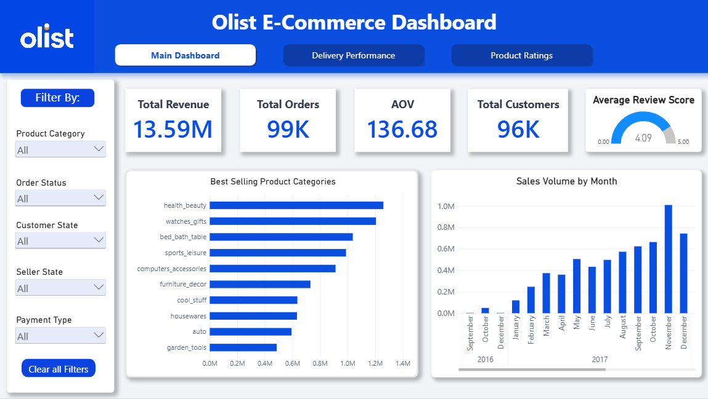
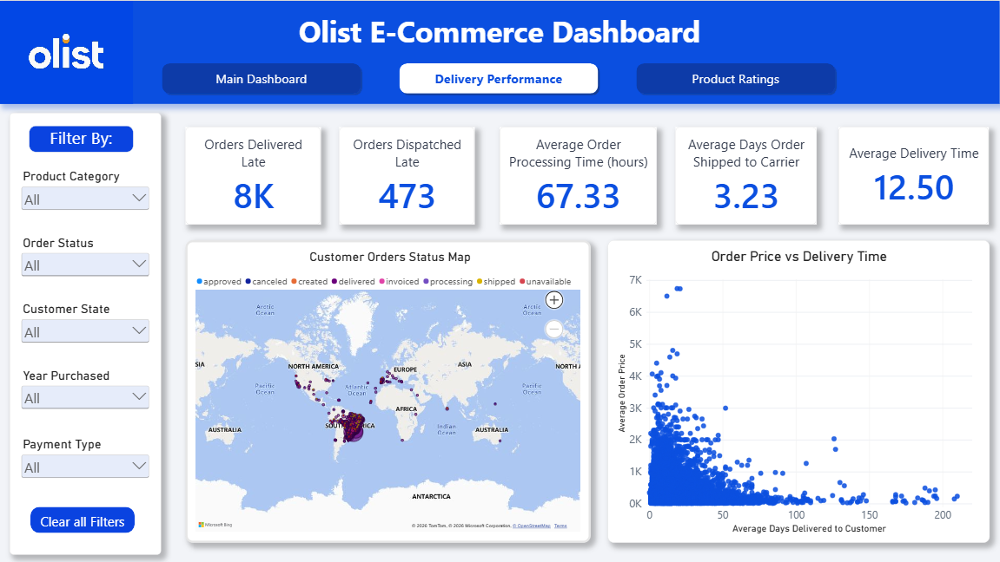
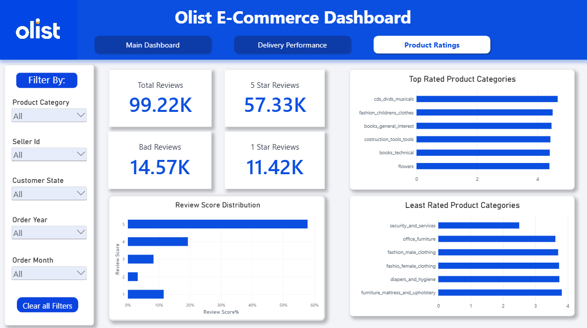

# Power BI Dashboard

## Overview

This dashboard presents an interactive analysis of Olist Brazilian E-Commerce data, focusing on sales performance, delivery operations, and customer satisfaction.

## Dashboard Pages

### 1. Main Dashboard
Provides a high-level view of revenue, order volume, average order value, customer count, monthly sales trends, and product category performance.

### 2. Delivery Performance
Examines late deliveries, dispatch delays, order processing time, shipping duration, and delivery duration.

### 3. Product Ratings
Explores review volume, average review score, five-star reviews, low ratings, and category-level rating patterns.

## Features

- KPI cards for important business metrics
- Interactive filters for relevant dimensions such as product category, order status, customer state, seller state, and payment type
- Time-based sales analysis
- Delivery and customer-review analysis

## Files

- [View the dashboard PDF](olist_dashboard.pdf) — Exported dashboard preview.

The editable `.pbix` file is not included in the current repository upload.

## Important Metric Note

Revenue is calculated using order-item prices. Payment value is a separate measure and should not be treated as interchangeable with item-price revenue.

The dashboard is intended to support exploratory analysis and identify patterns that may warrant further investigation.
